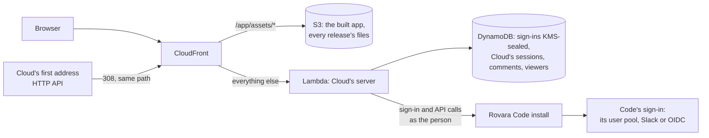

# Deploying Rovara Cloud

This guide is for Rovara staff who deploy **Rovara Cloud**: the web app and Cloud's server
(`packages/cloud-server`), on top of an existing **Rovara Code** install. Cloud has no user pool, workers or
Slack service of its own. People sign in to Cloud through Code, and Cloud calls Code's API as them, so
anyone Code lets in can use Cloud, with the projects Code gives them.

For a new company the order is always:

1. **Deploy Rovara Code.** See [Installing Rovara](https://github.com/PrepLabsAI/Rovara/blob/mainline/docs/install.md). Code brings the sign-in, the user pool (or
   Slack, or the company's OIDC), the workers and everything else.
2. **Deploy Rovara Cloud** through its release pipeline. That's this guide.
3. **Register Cloud with Code**, once, as a Code administrator.



## What gets deployed

**`rovara-cloud-<env>-web`** (`infra/lib/cloud-web.ts`) is Cloud. A release causes no gap: any number of
copies of the server run at once, and a release switches them to the new version together (#11).

- **CloudFront**, at Cloud's HTTPS address (`CloudUrl`).
  - `/app/assets/*` comes from **S3**. Every release's files stay, so a page opened before a release
    still finds its chunks.
  - Everything else goes to **Lambda** (`scripts/cloud-lambda.ts`): the page shell, with a fresh nonce
    on each request, and Cloud's API.
- **DynamoDB**, one table (`packages/cloud-server/src/dynamo-stores.ts`). It is kept if the stack is
  deleted, and can be restored to any point in time. It holds:
  - **Sign-ins,** under a hash of the cookie, never the cookie. Their tokens are sealed with the stack's
    own **KMS key**, which only the function's role may use. A sign-in ends after 12 hours unused or 7
    days after it started, and signing out also ends it at Code.
  - **Cloud's sessions,** with their followers and comments.
  - **Who is viewing** a session.
- **Settings read at run time:** the function reads its own address from the SSM parameter
  `/rovara-cloud/<env>/web/origin`, and its client secret from Secrets Manager. It reads both again every
  five minutes, so a new secret needs no restart.

**`rovara-cloud-<env>-app`** (`infra/lib/cloud-app.ts`) is Cloud's first address, `FirstUrl`. It used to run
Cloud on one Fargate task. Now its HTTP API answers every request with a **308** to the same path and query
at `CloudUrl`, from a small function, so old links and bookmarks still work.

It also makes **Cloud's client secret**, `rovara-cloud/<env>/code-client-secret`, which the web stack reads by
name. The secret starts as a placeholder and is kept if the stack is deleted.

**Left behind when the Fargate app went** (kept on delete), to remove by hand once you're sure:
- the EFS file system that held Cloud's sessions, already copied to the table, and its backups;
- the Fargate sign-ins' KMS key;
- the old log group.

**The release check.** While `cdk deploy` runs, the pipeline asks `CloudUrl` for `/app` and `/v1/web/me`
every second. Any 5xx or failed connection fails the release, even if the deploy succeeded, and the errors
are listed in the deploy job's log.

## Setting up the pipeline (once)

The pipeline is the stack `rovara-cloud-<env>-pipeline` (`infra/lib/cloud-release-pipeline.ts`), in the
same account and region as the Cloud it deploys. It asks for two things:

- **`GitHubConnectionArn`:** an authorized CodeConnections GitHub connection that can read
  `PrepLabsAI/Rovara-cloud`. (GitHub organization settings, GitHub Apps, AWS Connector for GitHub,
  repository access.)
- **`CodeUrl`:** the Rovara Code install's API address. It's the `ApiEndpoint` output of Code's control
  plane stack:

  ```sh
  aws cloudformation describe-stacks --region us-east-1 --stack-name <Code's control plane stack> \
    --query "Stacks[0].Outputs[?OutputKey=='ApiEndpoint'].OutputValue" --output text
  ```

  The control plane stack is `AgentXControlPlane` for the legacy AgentX deployment, and
  `rovara-cloud-<env>-control-plane` for a named install.

The account must be CDK-bootstrapped (`cdk bootstrap`). Then, from a checkout of `cloud/next`:

```sh
npm ci && npx tsc -b infra
npx cdk deploy RovaraCloudPipeline --app 'node infra/dist/bin/agentx.js' \
  -c rovaraCloudPipeline=<env> -c agentxRegion=us-east-1 \
  --parameters GitHubConnectionArn=<connection ARN> --parameters CodeUrl=<Code's API address>
```

The deploy job has no administrator access. It can assume only the account's CDK bootstrap roles, and read
the web stack's outputs for the release check. The pipeline never deploys itself: run the command above
again after a change to `cloud-release-pipeline.ts`.

## Releasing

```sh
git tag v<x.y.z> origin/cloud/next && git push origin v<x.y.z>
```

A `vX.Y.Z` tag starts `rovara-cloud-<env>-release`. Prerelease tags (`v1.2.3-rc1`) and branch pushes don't.
Approve the run in the CodePipeline console. The Deploy stage runs `npm ci`, builds `infra` and the web
app, then deploys the web stack and the first address with the release check around them. It takes a few
minutes.

## Registering Cloud with Code (once)

After the first deploy, the web stack's outputs give you everything:

| Output | What it is |
|---|---|
| `CloudUrl` | Cloud's web app |
| `CallbackUrl` | The redirect Code must allow for Cloud |
| `RegisterWithCode` | The registration command, with that redirect filled in |
| `ClientSecretName` | Where Cloud reads its secret |

1. As a Rovara Code administrator (`npx @preplabsai/rovara-code login --admin` against Code), run
   `RegisterWithCode`. It registers the confidential sign-in client `rovara-cloud` with full access, and
   writes its secret, shown only once, to `rovara-cloud-secret.txt`.
2. Put the secret into Cloud, then delete the file:

   ```sh
   aws secretsmanager put-secret-value --region us-east-1 --secret-id rovara-cloud/<env>/code-client-secret \
     --secret-string "$(cat rovara-cloud-secret.txt)" && rm rovara-cloud-secret.txt
   ```

3. Within five minutes, open `CloudUrl` and sign in. You go through Code's sign-in and come back to Cloud.

A later release keeps the secret. To rotate it, run `admin sign-in-client update rovara-cloud --rotate-secret
--secret-file <file>` on Code, then repeat steps 2 and 3.

## Running it

- **Who can sign in:** whoever Code's sign-in admits. Change that on Code (its user pool groups, Slack or
  OIDC settings), not on Cloud.
- **Logs:** the web stack's log group (the function's).
- **Sign everyone out:** delete the `SIGNIN#` items in the table. Their tokens stay valid at Code until they
  expire there; ending them at Code is Code's "end all sessions".

## Running it on your computer

```sh
npm run build:web
ROVARA_CODE_URL=https://<code api> ROVARA_CLIENT_SECRET_FILE=<file> npm run cloud:local
```

This needs the client registered with `--loopback`. See `packages/cloud-server/README.md`.

## Removing it

Delete `rovara-cloud-<env>-app`, `rovara-cloud-<env>-web`, and `rovara-cloud-<env>-pipeline` if it's no longer
needed. Some resources are kept on delete; remove them by hand once you're sure:
- the table and its KMS key;
- the assets bucket;
- the client secret;
- the log groups;
- anything the Fargate app left behind (above).

On Code, remove the client with `admin sign-in-client remove rovara-cloud`.
