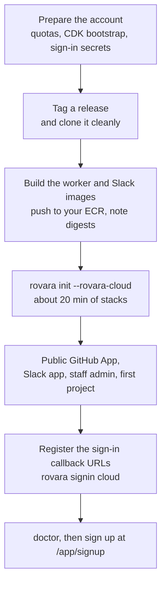

# Deploying Rovara Cloud

This guide is for Rovara staff who deploy **Rovara Cloud**: the hosted, multi-tenant Rovara that
companies sign up to themselves. It is not the self-hosted install in [Installing Rovara](install.md),
where one company runs Rovara in its own AWS account. Both come from the same code. Cloud mode is one
switch, `rovara init --rovara-cloud`, which turns on self-serve sign-up, organizations, staff routes
and an egress firewall.

Rovara Cloud is always deployed from a source checkout with the CDK. The Launch in AWS button and the
published templates cannot deploy it. There is no pipeline yet: every install and upgrade is run by
hand, as below.

> **Names.** From 0.7.0, every AWS resource of an environment is named under `rovara-cloud`: stacks
> `rovara-cloud-<env>-<part>`, parameters `/rovara-cloud/<env>/...`, secrets `rovara-cloud/<env>/...`,
> the tag `rovara-cloud:env`. The command is `rovara` (`agentx` still works). Environments installed
> before 0.7.0 were named under `agentx` and cannot be upgraded by this code. The `staging` environment
> in us-west-2 is one of them: it keeps running the code it has, and needs a reinstall to move on.

## How Rovara Cloud differs from a self-hosted install

| | Self-hosted | Rovara Cloud |
|---|---|---|
| Who uses it | One company | Many companies (organizations) |
| Edition | Enterprise | Public (decided by `--rovara-cloud`) |
| Deploy engine | Templates or CDK | CDK only, from a tagged checkout |
| Region | us-east-1 for the templates | Any region the CDK can deploy to (staging is us-west-2) |
| Sign-in | The install's admin pool, Slack or your company's OIDC | Plus a self-serve user pool: emailed code, and optionally GitHub and Google |
| GitHub App | Private, one installation | Public and shared; each organization installs it on its own GitHub account |
| Slack | The company's workspace | One Slack app; staff connect each organization's workspace |
| Who approves new egress domains | The company's admin | Rovara staff (the DNS firewall list is shared by every organization) |
| Spend | Operator-set budget | Each organization's own limits: $500 per org and $29 per member a month by default |

What cloud mode adds to the stacks:

- **Foundation:** a Route 53 DNS firewall on the VPC. Agent machines can resolve only the built-in
  allow-list plus the staff-approved project list; everything else gets NXDOMAIN. Alarms fire at 200
  blocked lookups in 5 minutes, and at more than 20 GiB an hour through a NAT gateway.
- **Control plane:**
  - The self-serve user pool `rovara-<env>-cloud`, with its hosted sign-in domain.
  - The company admin console in the web app.
  - An hourly reminder for GitHub installs waiting on a GitHub admin.
  - A five-minute sync of approved domains into the firewall.
  - A cross-account role assumption for the CloudWatch connector, limited to external IDs `rovara-org_*`.

## The install at a glance



## Before you start

You need:

- **An AWS account used only for Rovara Cloud,** with admin credentials. The CDK engine needs admin
  for installs and upgrades; the operator role that `init` creates is refused for them.
- **Room in the region's quotas:**
  - At least 1 EC2 On-Demand Standard vCPU (`L-1216C47A`).
  - Two free Elastic IPs (`L-0263D0A3`), for the two NAT gateways.
  - **A Lambda concurrency limit above 10.** The audit ledger reserves concurrency, and a new
    account's limit of 10 fails the deploy. `upgrade` has `--no-reserved-concurrency` for this;
    `init` does not, so ask AWS Support to raise the limit before you install.
- **The CDK bootstrapped in the region.** `init` offers to run `npx cdk bootstrap aws://<account>/<region>`,
  and does it on its own with `--yes`.
- **Node 22.19 or newer** (`.node-version` pins 22.23.2), and **Docker with buildx able to build
  linux/arm64.** Every image is arm64.
- **A GitHub organization** that will own the shared, public Rovara GitHub App.
- **A Slack workspace** where you can create the install's Slack app.
- **An alert email address**, and Amazon Bedrock model access in the region, or another model
  provider's key (see [Model providers](model-providers.md)).
- **An environment name:** lower-case, at most 14 characters, no `--`, and without the words `aws`,
  `amazon` or `cognito`.
- **A sign-in domain prefix that is free in the region.** The default is `rovara-<env>`. Cognito
  domain prefixes are unique across every AWS account in a region, so pick another with
  `--cloud-domain-prefix` if that one is taken. It must not contain `aws`, `amazon` or `cognito`.

### Optional sign-in methods

Without any of these, people sign up with a code emailed by Cognito's own sender, which has a low
daily cap. Each method can be added at install time or later with `rovara signin cloud`. Adding it
later is easier, because that command prints the callback URLs you have to register.

Store every client secret in Secrets Manager, in the environment's own account and region, as JSON
`{"clientSecret": "..."}`, under a name that starts with `rovara-cloud/<env>/`. Pass the secret from a
file, never on the command line:

```sh
aws secretsmanager create-secret --region <region> \
  --name rovara-cloud/<env>/github-sign-in --secret-string file://github-sign-in.json
```

| Method | What to create first | URL to register |
|---|---|---|
| GitHub sign-in | A GitHub **OAuth app** (not the Rovara GitHub App), with scopes `read:user user:email` | `<ApiEndpoint>/v1/auth/callback/github`. It is the control-plane output `CloudIdentityGitHubCallbackUrl`, and exists only after the first deploy. |
| Google sign-in | A Google OAuth client | `https://<prefix>.auth.<region>.amazoncognito.com/oauth2/idpresponse` (output `CloudIdentityGoogleRedirectUri`). You can register it before you install. |
| Branded sign-in emails | A verified **domain** identity in Amazon SES, in the environment's region, out of the SES sandbox (the sandbox allows 200 messages a day, to verified addresses only) | None |

## 1. Tag a release and clone it

`init` deploys from a checkout that is clean and has exactly one `vX.Y.Z` tag on its commit.
Prerelease tags such as `v0.6.0-rc.1` are refused, and a later upgrade can never go to a lower
version. A tag that exists only on your machine works; `doctor` then warns that there is no
`release.json`, which is expected.

Tag the commit you mean to deploy, then make a fresh clone of that tag to deploy from:

```sh
git tag v<x.y.z> <commit> && git push origin v<x.y.z>
git clone --branch v<x.y.z> --depth 1 git@github.com:PrepLabsAI/Rovara-cloud.git rovara-cloud-<x.y.z>
cd rovara-cloud-<x.y.z>
npm ci && npm run build
```

Keep everything you produce outside this folder. A file left in it makes the tree dirty, and `init`
refuses a dirty tree. `dist/`, `node_modules/` and `cdk.out/` are ignored by git, so the build is
fine.

## 2. Build and push the images

A source deploy brings its own images: the worker image and the Slack service image, both
linux/arm64, both in **private ECR in the environment's own account and region**, and both passed by
digest. No stack creates these repositories, so create them once:

```sh
REGION=<region>; ENV=<env>; REG=<account>.dkr.ecr.$REGION.amazonaws.com
aws ecr create-repository --region $REGION --repository-name rovara-cloud-$ENV/worker
aws ecr create-repository --region $REGION --repository-name rovara-cloud-$ENV/slack
aws ecr get-login-password --region $REGION | docker login --username AWS --password-stdin $REG
```

Build and push both from the root of the clone. `--provenance=false --sbom=false` makes buildx push
a single arm64 image, so the digest you read back is the image's own:

```sh
OUT=$(mktemp -d)   # outside the checkout
for image in worker slack; do
  dockerfile=environments/base/Dockerfile
  [ "$image" = slack ] && dockerfile=environments/slack/Dockerfile
  docker buildx build --platform linux/arm64 --provenance=false --sbom=false \
    --file "$dockerfile" --tag "$REG/rovara-cloud-$ENV/$image:<x.y.z>" --push \
    --metadata-file "$OUT/$image.json" .
  echo "$image=$REG/rovara-cloud-$ENV/$image@$(jq -r '."containerimage.digest"' "$OUT/$image.json")"
done
```

For the `staging` environment in account 944937319445 only, add `--build-arg CATALOG_FLAVOR=staging`
to the worker build, so the worker trusts the staging catalog key. Leave it out everywhere else.

The worker also needs the SHA-256 of its boot script, taken from the same checkout the image was
built from. Workers check it at every boot, so an image paired with an old hash fails them all:

```sh
shasum -a 256 packages/worker/ec2/boot-stage2.sh | cut -d' ' -f1    # sha256sum on Linux
```

There is no flag for the browser executor image, so a source deploy runs without browser checks.

## 3. Run `init`

Run the CLI you just built, from the clone, with admin credentials for the account:

```sh
export AWS_PROFILE=<admin profile for the Rovara Cloud account>
node packages/cli/dist/bin.js --env <env> init --region <region> \
  --engine cdk --source "$PWD" --rovara-cloud \
  --worker-image <worker image@sha256:…> --boot-stage2-sha256 <hash> \
  --slack-image <slack image@sha256:…> \
  --github-account <github org> --alert-email <address>
```

Type `--engine cdk` even though `--rovara-cloud` implies it: two early checks read only the typed
flag. Leave out `--edition`: cloud is always the Public edition, `--edition enterprise` is refused,
and staging was installed without it. Add the sign-in flags only if you prepared them:

| Flags | Effect |
|---|---|
| `--github-sign-in-client-id` and `--github-sign-in-client-secret-arn` | Offer sign-up and sign-in with GitHub. The two go together. |
| `--google-client-id` and `--google-client-secret-arn` | Offer Google. The two go together. |
| `--cloud-domain-prefix <prefix>` | The hosted sign-in domain, instead of `rovara-<env>`. |

`init` opens its install page on `127.0.0.1` and walks the same steps as a self-hosted install
([The install page](install.md#the-install-page)). Run the same command again to resume after a
failure. The error message suggests a shorter command; keep `--engine cdk` and `--source` on it.

**You cannot change your mind later.** An install that started without `--rovara-cloud` cannot be
resumed or upgraded into a cloud one, nor the other way round. The cloud user pool is created with
deletion protection and is kept when the stack is deleted.

### What the steps do on Rovara Cloud

Most steps run exactly as on a self-hosted install. These are the ones to know:

1. **Stacks** (about 20 minutes): `rovara-cloud-<env>-access`, `-foundation`, `-identity`, `-runtime`,
   `-control-plane` and `-slack`, in that order. The self-serve user pool is in the control-plane
   stack.
2. **The GitHub App.** `init` creates it from a manifest that already makes it public, with the
   install callback `<ApiEndpoint>/v1/github/install/callback`, user authorization during install,
   redirect on update, and Members read-only. You install it on `--github-account` as usual, and
   `init` waits until it sees a repository. If GitHub then shows an error page after the install,
   ignore it: it comes from the organization-connect callback, and `init` carries on.
   - If you reuse an App made beforehand (`--github-app-id`), it has no OAuth client. Run
     `rovara --env <env> github oauth set --client-id <id>` afterwards and apply the settings it
     prints.
3. **The Slack app** is created in your own workspace, exactly as on a self-hosted install. Customer
   workspaces are connected later by staff (see [Connecting a customer's Slack](#connecting-a-customers-slack)).
4. **The admin user is Rovara staff.** On Rovara Cloud, users of the identity stack's admin pool
   belong to no organization; they run the staff commands. Use a staff email for `--admin-email`.
5. **The first project and channel, and the first reply**, are set up in your own organization.
   They show the install works end to end. Customers create their own projects.

## 4. Turn on sign-in methods

When the control plane is up, read its sign-in outputs:

```sh
aws cloudformation describe-stacks --region <region> --stack-name rovara-cloud-<env>-control-plane \
  --query "Stacks[0].Outputs[?starts_with(OutputKey,'CloudIdentity') || OutputKey=='ApiEndpoint']"
```

Register `CloudIdentityGitHubCallbackUrl` in the GitHub OAuth app, and `CloudIdentityGoogleRedirectUri`
in the Google client. To add, change or turn off a method after the install, use `signin cloud`. It
runs as the operator role ([Running Rovara](day-two.md)), shows the change and asks first:

```sh
rovara --env <env> signin cloud --github-client-id <id> --github-client-secret-arn <arn>
rovara --env <env> signin cloud --google-client-id <id> --google-client-secret-arn <arn>
rovara --env <env> signin cloud --email-from "Rovara <signin@your-domain>"   # SES sender
rovara --env <env> signin cloud --no-google                                  # turn one off
```

`--email-from` checks that SES has verified the domain in the region, and warns while the account is
in the SES sandbox. Changing the Google secret's value takes a redeploy, because the stack reads it
at deploy time.

## 5. Check it

```sh
rovara --env <env> doctor --region <region>
```

Then sign up as a customer would, at `<ApiEndpoint>/app/signup`. There is no custom domain: the app
is served from the API Gateway address (staging: `https://sv3dwut47b.execute-api.us-west-2.amazonaws.com/app`).

## Upgrading

Upgrades work like the install: a clean clone at a newer tag, freshly built images, admin
credentials:

```sh
node packages/cli/dist/bin.js --env <env> upgrade --region <region> --source "$PWD" \
  --worker-image <…@sha256:…> --boot-stage2-sha256 <hash> --slack-image <…@sha256:…> --yes
```

- With a CLI built from source, the target is the checkout's tag. Older and prerelease targets are
  refused.
- `upgrade` prints every change. It stops before replacing a table, user pool, bucket, key or secret
  unless you name it with `--allow-replace <logical-id>`.
- It locks the environment while it runs, and runs `doctor` at the end. If a stack fails, the same
  command continues from that stack.
- In an account whose Lambda concurrency limit is still 10, pass `--no-reserved-concurrency` on every
  upgrade. `rovara` does not remember it.
- Images, the boot hash and the tag must all come from the same commit.

## Running Rovara Cloud

### How a company joins

1. **Sign up** at `<ApiEndpoint>/app/signup`. Signing in without an invite creates an organization
   with that person as owner, and `/app/welcome` asks for the company name.
2. **Connect GitHub** in the web onboarding, or with `rovara github connect`. The organization
   installs the shared GitHub App on its own GitHub account. The free trial starts here, one per
   GitHub account.
   - If the person is not a GitHub admin, GitHub sends their admin a request. The connection is
     made when the admin approves. Reminders go out hourly after 2 days, and the request expires
     after 7 days.
3. **Create projects** from repositories the connection reaches. Owners and admins can do this, and
   the creator becomes the project's first maintainer.
4. **Connect Slack:** staff connect the workspace (below), then an owner or admin binds a channel
   with `rovara --project <project> slack bind --channel <channel id>` and invites the bot.

### Staff duties

Staff sign in with `rovara --env <env> login`, as an admin-pool user. There is no staff web console;
everything below is the CLI.

| Duty | Command |
|---|---|
| Approve or reject the websites projects ask to reach | `rovara --env <env> admin egress pending`, then `admin egress approve <org> <project:name> <domain>` or `admin egress reject … --reason <text>`. An approved domain joins the shared firewall list at once. |
| Connect a customer's Slack workspace to their organization | `rovara --env <env> admin slack connect-team --org <org id> --team <T…>`, and `disconnect-team` to release it. |
| Re-deliver a lost GitHub install event | In the GitHub App's settings, Advanced, Recent Deliveries, within about 3 days. Use it when an approved GitHub admin request did not connect ([day-two](day-two.md#github-connection-requests-rovara-cloud)). |
| Watch the egress alarms | They notify `rovara-cloud-<env>-alerts`. |

### Connecting a customer's Slack

Slack is not self-serve. The install has a single Slack app. Staff connect a customer's workspace to
the customer's organization with `admin slack connect-team`, and the customer binds their own
channels. How a customer installs that one Slack app in their own workspace is not covered by the
code; it has not been tried with a real customer workspace.

### What Rovara Cloud does not offer

- **Off in the Public edition:** SSO, groups and group locks, the Auditor role, custom model
  endpoints, private and stdio MCP servers, continuous audit export.
- **Refused at deploy:** private package registries (CodeArtifact).
- **Refused at run time:** AI navigation steps in browser checks, because their model calls are not
  yet charged to an organization's spend limits.
- **Not working:** test services, except on staging. No production signing key for the service
  catalog has been named yet.

## Known gaps

These are open in the code on `cloud/next`. Fix them before a production Rovara Cloud:

- **Invite links point at `https://rovara.dev/join`.** That site is not in this repo, and the
  control-plane parameter `RovaraWebOrigin` cannot be set from the CLI. Staging still uses the
  default.
- **No custom domain.** Users see the raw API Gateway address.
- **No pipeline.** Installs and upgrades are manual, and the repository holds no AWS role.
- **Customers cannot set their own spend limits** in the app: nothing calls the budget route yet.
  There is a trial, but no billing.
- **No self-serve Slack,** and the shared Slack app's install in a customer workspace is unproven.
- **The GitHub "request" case** (a non-admin asking their admin) has not been verified on staging.
- **Some failures go unwatched.** The metric for failed GitHub-request notices has no alarm.
- **`destroy` leaves the ECR repositories behind:** the worker and Slack repositories you created,
  and the service catalog repositories.

## Removing a Rovara Cloud environment

Follow [Removing Rovara](teardown.md). The cloud user pool has deletion protection, so turn it off
before deleting it, and delete it only when every organization's data may go. `--keep-data` keeps it.
Delete the `rovara-cloud-<env>/worker` and `rovara-cloud-<env>/slack` ECR repositories by hand.
