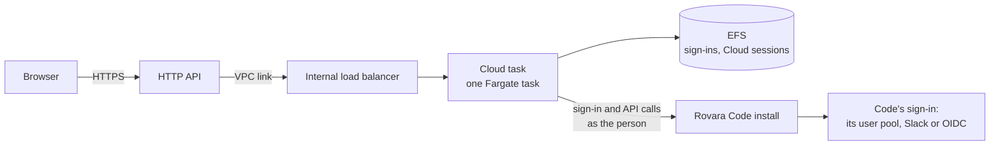

# Deploying Rovara Cloud

This guide is for Rovara staff who deploy **Rovara Cloud**: the web app and Cloud's server
(`packages/cloud-server`), on top of an existing **Rovara Code** install. Cloud has no user pool, workers or
Slack service of its own. People sign in to Cloud through Code, and Cloud calls Code's API as them, so
anyone Code lets in can use Cloud, with the projects Code gives them.

For a new company the order is always:

1. **Deploy Rovara Code.** See [Installing Rovara](install.md). Code brings the sign-in, the user pool (or
   Slack, or the company's OIDC), the workers and everything else.
2. **Deploy Rovara Cloud** through its release pipeline. That's this guide.
3. **Register Cloud with Code**, once, as a Code administrator.



## What gets deployed

One stack, `rovara-cloud-<env>-app` (`infra/lib/cloud-app.ts`):

- **An HTTP API**, the HTTPS address people open. It reaches an internal load balancer through a VPC
  link, so nothing travels as plain HTTP over the internet.
- **One Fargate task (arm64)** running `scripts/cloud-server.ts`: the web app's pages and Cloud's
  server in one Node process. The image is built from `environments/cloud/Dockerfile` during the deploy.
- **EFS**, encrypted, holding people's sign-ins and Cloud's sessions, so a restart or a release keeps them.
- **The secret `rovara-cloud/<env>/code-client-secret`**, Cloud's secret as Code's sign-in client
  `rovara-cloud`. It starts as a placeholder.

There is only ever one task, and a release stops the old task before it starts the new one, which takes
under a minute. The reason: Cloud's session stores are files, and who is viewing a session is kept in
the task's memory. Running more than one task needs shared stores first, which is application work.

## Setting up the pipeline (once)

The pipeline is the stack `rovara-cloud-<env>-pipeline` (`infra/lib/cloud-release-pipeline.ts`), in the
same account and region as the Cloud it deploys. It asks for two things:

- **`GitHubConnectionArn`:** an authorized CodeConnections GitHub connection that can read
  `PrepLabsAI/Rovara-cloud`. (GitHub organization settings, GitHub Apps, AWS Connector for GitHub,
  repository access.)
- **`CodeUrl`:** the Rovara Code install's API address. It's the `ApiEndpoint` output of Code's control
  plane stack:

  ```sh
  aws cloudformation describe-stacks --region us-east-1 --stack-name <Code's control plane stack> \
    --query "Stacks[0].Outputs[?OutputKey=='ApiEndpoint'].OutputValue" --output text
  ```

  The control plane stack is `AgentXControlPlane` for the legacy AgentX deployment, and
  `rovara-cloud-<env>-control-plane` for a named install.

The account must be CDK-bootstrapped (`cdk bootstrap`). Then, from a checkout of `cloud/next`:

```sh
npm ci && npx tsc -b infra
npx cdk deploy RovaraCloudPipeline --app 'node infra/dist/bin/agentx.js' \
  -c rovaraCloudPipeline=<env> -c agentxRegion=us-east-1 \
  --parameters GitHubConnectionArn=<connection ARN> --parameters CodeUrl=<Code's API address>
```

The deploy job has no administrator access. It can only assume the account's CDK bootstrap roles.

## Releasing

```sh
git tag v<x.y.z> origin/cloud/next && git push origin v<x.y.z>
```

A `vX.Y.Z` tag starts `rovara-cloud-<env>-release`. Prerelease tags (`v1.2.3-rc1`) and branch pushes don't.
Approve the run in the CodePipeline console. The Deploy stage runs `npm ci`, builds `infra`, and runs
`cdk deploy RovaraCloudApp`, which builds the image and deploys the one stack: a few minutes, mostly the
image build.

## Registering Cloud with Code (once)

After the first deploy, the stack's outputs give you everything:

| Output | What it is |
|---|---|
| `CloudUrl` | Cloud's web app |
| `CallbackUrl` | The redirect URL Code must allow for Cloud |
| `RegisterWithCode` | The registration command, with that URL filled in |
| `ClientSecretName` | Where Cloud reads its secret |
| `RestartCommand` | Restarts Cloud, so it reads a changed secret |

1. As a Rovara Code administrator (`npx @preplabsai/rovara-code login --admin` against Code), run
   `RegisterWithCode`. It registers the confidential sign-in client `rovara-cloud` with full access and
   writes its secret, shown only once, to `rovara-cloud-secret.txt`.
2. Put the secret into Cloud, then delete the file:

   ```sh
   aws secretsmanager put-secret-value --region us-east-1 --secret-id rovara-cloud/<env>/code-client-secret \
     --secret-string "$(cat rovara-cloud-secret.txt)" && rm rovara-cloud-secret.txt
   ```

3. Run `RestartCommand`. Open `CloudUrl` and sign in: you go through Code's sign-in and come back to Cloud.

A later release keeps the secret. To rotate it, run `admin sign-in-client update rovara-cloud --rotate-secret
--secret-file <file>` on Code, then repeat steps 2 and 3.

## Running it

- **Who can sign in:** whoever Code's sign-in admits. Change that on Code (its user pool groups, Slack or
  OIDC settings), not on Cloud.
- **Logs:** the stack's log group, stream prefix `cloud`.
- **Restart:** `RestartCommand`. Sign-ins and Cloud's sessions survive it.

## Running it on your computer

```sh
npm run build:web
ROVARA_CODE_URL=https://<code api> ROVARA_CLIENT_SECRET_FILE=<file> npm run cloud:local
```

This needs the client registered with `--loopback`. See `packages/cloud-server/README.md`.

## Removing it

Delete `rovara-cloud-<env>-app`, and `rovara-cloud-<env>-pipeline` if it's no longer needed. The EFS file
system, the client secret and the log groups are kept: delete them by hand once you're sure. On Code, remove
the client with `admin sign-in-client remove rovara-cloud`.
