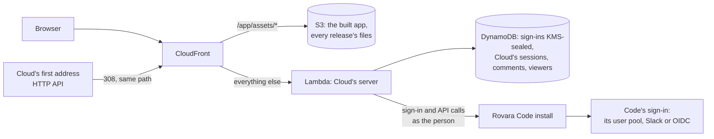

# Deploying Rovara Cloud

This guide is for Rovara staff who deploy **Rovara Cloud**: the web app and Cloud's server
(`packages/cloud-server`), on top of an existing **Rovara Code** install. Cloud has no user pool, workers or
Slack service of its own. People sign in to Cloud through Code, and Cloud calls Code's API as them, so
anyone Code lets in can use Cloud, with the projects Code gives them.

For a new company the order is always:

1. **Deploy Rovara Code.** See [Installing Rovara](https://github.com/PrepLabsAI/Rovara/blob/mainline/docs/install.md). Code brings the sign-in, the user pool (or
   Slack, or the company's OIDC), the workers and everything else.
2. **Deploy Rovara Cloud** through its release pipeline. That's this guide.
3. **Register Cloud with Code**, once, as a Code administrator.



## What gets deployed

**`rovara-cloud-<env>-web`** (`infra/lib/cloud-web.ts`) is Cloud. A release causes no gap: any number of
copies of the server run at once, and a release switches them to the new version together (#11).

- **CloudFront**, at Cloud's HTTPS address (`CloudUrl`).
  - `/app/assets/*` comes from **S3**. Every release's files stay, so a page opened before a release
    still finds its chunks.
  - Everything else goes to **Lambda** (`scripts/cloud-lambda.ts`): the page shell, with a fresh nonce
    on each request, and Cloud's API.
- **DynamoDB**, one table (`packages/cloud-server/src/dynamo-stores.ts`). It is kept if the stack is
  deleted, and can be restored to any point in time. It holds:
  - **Sign-ins,** under a hash of the cookie, never the cookie. Their tokens are sealed with the stack's
    own **KMS key**, which only the function's role may use. A sign-in ends after 12 hours unused or 7
    days after it started, and signing out also ends it at Code.
  - **Cloud's sessions,** with their followers and comments.
  - **Who is viewing** a session.
- **Settings read at run time:** the function reads its own address from the SSM parameter
  `/rovara-cloud/<env>/web/origin`, and its client secret from Secrets Manager. It reads both again every
  five minutes, so a new secret needs no restart.

**`rovara-cloud-<env>-app`** (`infra/lib/cloud-app.ts`) is Cloud's first address, `FirstUrl`. It used to run
Cloud on one Fargate task. Now its HTTP API answers every request with a **308** to the same path and query
at `CloudUrl`, from a small function, so old links and bookmarks still work.

It also makes **Cloud's client secret**, `rovara-cloud/<env>/code-client-secret`, which the web stack reads by
name. The secret starts as a placeholder and is kept if the stack is deleted.

**Left behind when the Fargate app went** (kept on delete), to remove by hand once you're sure:
- the EFS file system that held Cloud's sessions, already copied to the table, and its backups;
- the Fargate sign-ins' KMS key;
- the old log group.

**The release check.** While `cdk deploy` runs, the pipeline asks `CloudUrl` for `/app` and `/v1/web/me`
every second. Any 5xx or failed connection fails the release, even if the deploy succeeded, and the errors
are listed in the deploy job's log.

## Setting up the pipeline (once)

The pipeline is the stack `rovara-cloud-<env>-pipeline` (`infra/lib/cloud-release-pipeline.ts`), in the
same account and region as the Cloud it deploys. It asks for two things:

- **`GitHubConnectionArn`:** an authorized CodeConnections GitHub connection that can read
  `PrepLabsAI/Rovara-cloud`. (GitHub organization settings, GitHub Apps, AWS Connector for GitHub,
  repository access.)
- **`CodeUrl`:** the Rovara Code install's API address. It's the `ApiEndpoint` output of Code's control
  plane stack:

  ```sh
  aws cloudformation describe-stacks --region us-east-1 --stack-name <Code's control plane stack> \
    --query "Stacks[0].Outputs[?OutputKey=='ApiEndpoint'].OutputValue" --output text
  ```

  The control plane stack is `AgentXControlPlane` for the legacy AgentX deployment, and
  `rovara-cloud-<env>-control-plane` for a named install.

**Which company:** Cloud takes each person's company and company role only from Rovara Code's access check (DEC 253z).
A person Code names no company for is refused on every company route ("You're not in a company yet."). The web stack has
no company setting.

*Upgrading from a stack that had the `CompanyId` parameter:* the template no longer has it, so the deploy must not pass
`CompanyId` any more (CloudFormation refuses a parameter the template doesn't declare: remove it from your parameter
list or `--parameters` overrides). On staging the old stopgap value was `org_jckf8av6ri11rszcdjsa` (DEC 254), which is
exactly the company Code's access check now names for the founders, so no company data moves. Code must answer
`companyId` and `companyRole` (Code PR #820) before this Cloud is deployed, or every company route refuses.

The web stack takes `GatewayMeterTableName` (default empty: an install with no model gateway, where People and limits says "not connected yet"):
pass the gateway stack's **Meter** resource's physical table name on the first update that enables People and limits. Compare the gateway's `Issuer` output with `CodeUrl` plus `/v1/auth` before that update; they must match
exactly. The web role gets only conditioned item reads on that table. Subsequent release deploys keep the parameter, as for the product key settings.

The web stack's product AI settings (staging, with the `ProductKeys*` parameters and `ModelGatewayUrl`) also take an optional
**`BedrockTemplateUrl`** (default empty): the address of the role template a company's AWS admin deploys for "your own Bedrock"
(`docs/model-gateway-bedrock-byo.md`). Empty, the Bedrock routes answer 501 and the server gets no
`CLOUD_BEDROCK_TEMPLATE_URL`. Set, it must be an `https` address of a `.json` file that is not an S3 host (the stack refuses anything
else), and `ModelGatewayUrl` must be set too. The value is the file as committed on the public repo, pinned to a merge commit:

```
https://raw.githubusercontent.com/PrepLabsAI/Rovara/<merge sha>/docs/bedrock/rovara-bedrock-role.json
```

(use the merge sha of public PR #778 or a later one that carries the file). Before setting it, check the file is the one the
set-up command expects:

```sh
curl -fsS https://raw.githubusercontent.com/PrepLabsAI/Rovara/<merge sha>/docs/bedrock/rovara-bedrock-role.json | shasum -a 256
# dad14bedc8d2a7e704f03d041f39809c06eeb20e8e41fa4b61c047cdb7a474ea
```

Like `ModelGatewayUrl`, it is a parameter of the web stack, set by hand on the first deploy and kept by later deploys.

A named test environment's web stack (not `production`) also has **`AnswersEnabled`** (`1`, the default, or `0`): the server's
`ROVARA_ANSWERS_ENABLED`, which turns on the smart Just answer's Ask boxes (lead 4 J3, DEC 254z-amend2; on unless set to `0`, also for the local server, DEC 254zzz448). On needs the model gateway's
answers purpose deployed; Code still decides who may ask. Like the other parameters, a later deploy keeps the value the operator set.
To turn it off: deploy the web stack with `--parameters AnswersEnabled=0`.

The account must be CDK-bootstrapped (`cdk bootstrap`). Then, from a checkout of `cloud/next`:

```sh
npm ci && npx tsc -b infra
npx cdk deploy RovaraCloudPipeline --app 'node infra/dist/bin/agentx.js' \
  -c rovaraCloudPipeline=<env> -c agentxRegion=us-east-1 \
  --parameters GitHubConnectionArn=<connection ARN> --parameters CodeUrl=<Code's API address>
```

Each environment's deploy switches come from `CLOUD_PIPELINE_SWITCHES` in `infra/lib/cloud-release-pipeline.ts`, never from
the run: the `staging` pipeline deploys with `-c rovaraModelGatewayProductAi=on` (the product AI settings: switch the web stack on
by hand first, with its `ProductKeys*` parameters and `ModelGatewayUrl`, which later deploys keep: a release deploy of a staging
web stack that never had them fails), `production` and `beta` carry the same switch (each switched on by hand first, with its own gateway). The pipeline stack itself must be redeployed once for a
changed switch to take effect. Run the pipeline
command above again after changing them.

The deploy job has no administrator access. It can assume only the account's CDK bootstrap roles, and read
the web stack's outputs for the release check. The pipeline never deploys itself: run the command above
again after a change to `cloud-release-pipeline.ts`.

### Beta: a pipeline that deploys into another account

Beta Cloud (`app.beta.rovara.dev`, on beta Code at `https://beta.rovara.dev`) lives in the beta account. Its
pipeline, `rovara-cloud-beta-pipeline`, runs in the production account, which holds the GitHub connection. This is
how Rovara Code's beta release works too (Rovara-cloud#269).

- `CLOUD_PIPELINE_SEPARATE_ACCOUNT_ENVS` in `cloud-release-pipeline.ts` says beta deploys into another account; the account itself is never in git: pass `-c agentxAccount=<beta account>` when you deploy the pipeline stack by hand.
- The deploy job passes `-c agentxAccount=<that account>`, so `cdk deploy` goes through beta's CDK bootstrap roles.
- The release check reads the web stack's address through beta's lookup role.
- The pipeline's role boundary allows exactly those roles.

The beta account's bootstrap must trust the production account. Run this once, as the beta account:

```sh
npx cdk bootstrap aws://<beta account>/us-east-1 --trust <production account> --trust-for-lookup <production account> \
  --cloudformation-execution-policies arn:aws:iam::aws:policy/AdministratorAccess
```

Deploy the pipeline as the production account, with `-c rovaraCloudPipeline=beta`, the production GitHub connection and
`CodeUrl=https://beta.rovara.dev`. A `vX.Y.Z` tag then starts both `rovara-cloud-production-release` and `rovara-cloud-beta-release`,
each waiting for its own approval: approve beta first.

## Releasing

```sh
git tag v<x.y.z> origin/cloud/next && git push origin v<x.y.z>
```

A `vX.Y.Z` tag starts `rovara-cloud-<env>-release`. Prerelease tags (`v1.2.3-rc1`) and branch pushes don't.
Approve the run in the CodePipeline console. The Deploy stage runs `npm ci`, builds `infra` and the web
app, then deploys the web stack and the first address with the release check around them. It takes a few
minutes.

## Release order with Code: Cloud's text parsers ship first

Cloud and Code are released separately, so for a while a newer one runs against an older other. Some of Cloud's parsers are strict about the **text** Code sends, not only its shape: the "Setup needs repair" card's
sentence must match one of Code's two templates exactly, the wiki build's sentences must be ones Cloud lists, and several of Code's refusals are matched word for word. A Code that changes one of those words
before Cloud knows them makes Cloud refuse the whole answer (the card or panel shows "could not be read just now").

**Rule: Cloud's strict text parsers ship before Code changes the text.** When a Code change edits a sentence or message Cloud parses, release Cloud with a parser that takes both the old and the new text first,
then install the Code. Never install the Code first.

- **Cloud train 15 (or newer) must be installed BEFORE any Code that contains Code train 22** (the "don't block work" change, DEC 254zzz447). Code train 22 ends the repair card's sentence with "Work continues;
  results may be less reliable until setup is fixed." where earlier Code ends it with "Rovara cannot build on this project until it is fixed." Cloud before train 15 accepts only the old ending, so under a Code with
  train 22 every open repair card would answer 503. Train 15 and newer accept both endings and show Cloud's own words either way.
- **Check it before every Code install:** `npm run contract:drift -- check --code-ref <the Code release ref> --code-repo <a Code clone>`. Besides the schemas, it reads the sentences Code builds
  (`scripts/contract-drift/text-rules.ts`) and fails when one is not taken by the Cloud being released. A failure means: change Cloud's parser first (accept the new text, keep the old), release Cloud, then Code.
- **A new strict parser of Code text needs a rule** in `scripts/contract-drift/text-rules.ts` (Cloud's parser, Code's file and expression), and `npm run contract:drift -- snapshot-text --code-ref origin/code/next --code-repo <clone>`
  to refresh the pinned sentences in `tests/fixtures/code-contract-snapshot/code-text.json`.

## Registering Cloud with Code (once)

After the first deploy, the web stack's outputs give you everything:

| Output | What it is |
|---|---|
| `CloudUrl` | Cloud's web app |
| `CallbackUrl` | The redirect Code must allow for Cloud |
| `RegisterWithCode` | The registration command, with that redirect filled in |
| `ClientSecretName` | Where Cloud reads its secret |

1. As a Rovara Code administrator (`npx @preplabsai/rovara-code login --admin` against Code), run
   `RegisterWithCode`. It registers the confidential sign-in client `rovara-cloud` with full access, and
   writes its secret, shown only once, to `rovara-cloud-secret.txt`.
2. Put the secret into Cloud, then delete the file:

   ```sh
   aws secretsmanager put-secret-value --region us-east-1 --secret-id rovara-cloud/<env>/code-client-secret \
     --secret-string "$(cat rovara-cloud-secret.txt)" && rm rovara-cloud-secret.txt
   ```

3. Within five minutes, open `CloudUrl` and sign in. You go through Code's sign-in and come back to Cloud.

A later release keeps the secret. To rotate it, run `admin sign-in-client update rovara-cloud --rotate-secret
--secret-file <file>` on Code, then repeat steps 2 and 3.

## Running it

- **Who can sign in:** whoever Code's sign-in admits. Change that on Code (its user pool groups, Slack or
  OIDC settings), not on Cloud.
- **Logs:** the web stack's log group (the function's).
- **Sign everyone out:** delete the `SIGNIN#` items in the table. Their tokens stay valid at Code until they
  expire there; ending them at Code is Code's "end all sessions".

## Running it on your computer

```sh
npm run build:web
ROVARA_CODE_URL=https://<code api> ROVARA_CLIENT_SECRET_FILE=<file> npm run cloud:local
```

This needs the client registered with `--loopback`. See `packages/cloud-server/README.md`.

## The model gateway's provider keys

The model gateway (`-c rovaraModelGateway=<env>`, deployed by hand, never by the pipeline) keeps each provider's key in a
retained secret. By default CloudFormation generates the secret's name: a fixed name stays reserved for its recovery window
after a failed create and a delete, which blocks making the stack again. The gateway reads the secret by ARN, so the name
doesn't matter to it.

- **Where to put the key:** the gateway stack's `ProviderKeySecrets` output lists the secrets' ARNs (names, with `fixed`), anthropic first. Store the
  real key as a new version (the secret starts as a generated placeholder; the console's edit is refused):
  `aws secretsmanager put-secret-value --secret-id <ARN from the output> --secret-string <key>` (give the key from a file, not
  the command line).
- **An environment deployed before this change** has the fixed name `rovara-cloud/<env>/model-gateway/provider/anthropic`.
  Keep deploying it with `-c rovaraModelGatewayProviderSecretNames=fixed`; without it, the next deploy would REPLACE the secret.
  The replacement is a new placeholder: the old secret, holding the real key, is retained but the gateway no longer reads it.
  Do not leave it that way: deploy with `fixed`, or copy the key into the new secret and then, once the old secret is no longer
  needed, delete it by hand. Check `cdk diff` shows no change to the secret before a deploy of an existing environment.
- **Moving an existing environment to generated names** (optional): deploy once without the flag, then put the key in the new secret
  at once (output `ProviderKeySecrets`). From that deploy the gateway reads the new secret, a placeholder until then, so its
  provider calls fail until you do, and it caches the key for up to five minutes. After it works, delete the old secret by hand (scheduling its deletion
  reserves the old name, which nothing uses again).
- **The key policy:** with fixed names it names the secrets' prefix; with generated names it can only name every secret of the
  account and Region (the secrets name the key, so the policy cannot name them). Only the serving role can still decrypt a stored
  value, and it is granted the provider secrets' ARNs only.

## Removing it

Delete `rovara-cloud-<env>-app`, `rovara-cloud-<env>-web`, and `rovara-cloud-<env>-pipeline` if it's no longer
needed. Some resources are kept on delete; remove them by hand once you're sure:
- the table and its KMS key;
- the assets bucket;
- the client secret;
- the model gateway's provider key secrets, its KMS key and its tables (a deleted secret keeps its name for its recovery window; the default generated names avoid that);
- the log groups;
- anything the Fargate app left behind (above).

On Code, remove the client with `admin sign-in-client remove rovara-cloud`.

## Required own-key backfill before the AI-default release

Existing companies with a connected Anthropic key or company Bedrock connection and no saved agent source must keep that source. Run this migration before deploying either the gateway default change or Cloud. New companies without a connection keep the billed Rovara AI default. Existing saved choices, including fallback order and damaged rows, are never overwritten.

The controller runs this with staging-aws.sh on staging first, then with the approved production operator session before rollout. Builders do not run AWS. Use the installed issuer (`CodeUrl` plus `/v1/auth`) and the exact company/product-key tables from that environment's Cloud web stack (CompanyTableName output, CodeUrl and ProductKeysTableName parameters). Do not substitute another environment's table or issuer.

Build the operator code locally:

```sh
npx tsc -b packages/model-gateway
```

Required sequence, with local operator credentials provided by the controller's existing wrapper:

```sh
node scripts/agent-own-key-backfill.mjs --dry-run --region "$AWS_REGION" --issuer "$CODE_ISSUER" --company-table "$COMPANY_TABLE" --product-table "$PRODUCT_KEYS_TABLE"
node scripts/agent-own-key-backfill.mjs --apply --region "$AWS_REGION" --issuer "$CODE_ISSUER" --company-table "$COMPANY_TABLE" --product-table "$PRODUCT_KEYS_TABLE"
node scripts/agent-own-key-backfill.mjs --dry-run --region "$AWS_REGION" --issuer "$CODE_ISSUER" --company-table "$COMPANY_TABLE" --product-table "$PRODUCT_KEYS_TABLE"
node scripts/agent-own-key-backfill.mjs --check --region "$AWS_REGION" --issuer "$CODE_ISSUER" --company-table "$COMPANY_TABLE" --product-table "$PRODUCT_KEYS_TABLE" \
  --record "/rovara-cloud/$ROVARA_ENV/release-checks/agent-own-key-backfill"
```

1. Review and retain the dry-run count and company/source list. Dry-run is also the default; it performs no writes.
2. Apply prints a complete read-only preview before the first write. Each candidate uses a transaction: its connection document revisions must still match and its AGENT_AI row must still be absent. Anthropic precedes Bedrock when both are connected, matching former own-key precedence. Only an existing AGENT_AI record kind is written, with source, version 1, timestamp and `updatedBy: backfill:DEC254zzz279`. No fallback is invented.
3. A concurrent choice or connection change refuses that company's transaction and exits unsuccessfully. Rerun dry-run and review the fresh list; do not force an overwrite. Uncertain writes or unreadable metadata also fail the run; a rerun safely discovers any write that already committed.
4. The final dry-run must show count 0. A rerun makes no write attempts and preserves saved versions/timestamps. Retain the apply and zero-candidate logs with release evidence. Run the `--check` command above again against the target environment immediately before the gateway rollout; a nonzero exit stops that rollout. A key connected after the backfill with no saved choice is preserved by gateway admission (Anthropic first, then Bedrock); only a company with neither defaults to company-billed Rovara AI. An explicit saved Rovara choice still wins. Connection-read failures refuse before any hold or send.

The command scans every page of both tables with consistent reads. Companies contributes company identifiers; ProductKeys contributes only partition/sort-key identifiers for `_learning` and `_company` metadata under the exact installed issuer. This includes connected companies with no Companies rows. It then reads only the two relevant parsed connection documents. Discovery errors abort the complete preview before any write. It never reads sealed key contents, decrypts a key, calls a provider or creates a feature switch. Operator apply requires the controller's existing DynamoDB transaction authority for these tables; no grant is added by this change.

**The release pipeline reads the recorded result, not the tables** (Rovara-cloud#313). The deploy job runs `--check --release-stack "${STACK_PREFIX}-web" --lookup-role <deploy account's CDK lookup role> --marker /rovara-cloud/<env>/release-checks/agent-own-key-backfill` before its deploy. The CDK lookup role is denied `kms:Decrypt`, so it can't scan the Companies or ProductKeys tables (both encrypted with KMS keys); it reads the web stack (`CodeUrl` plus `/v1/auth`, `CompanyTableName`, `ProductKeysTableName`) and the SSM String parameter the operator's last `--check ... --record` wrote. The release passes only if that record names this stack's own issuer and both tables, zero pending companies and a valid time; a missing, other-install, pending or malformed record blocks it. `--record` writes only after a run with zero candidates, and holds identifiers and counts only (issuer, table names, companies scanned, time), never company ids. Re-run the `--check ... --record` line after the backfill and before the first release of each environment; it needs an operator session that can read both tables. For cross-account beta, the parameter and the lookup role are in the deploy account.

After installation, prove on staging that a backfilled own-key company still uses that source, an explicit choice is unchanged, and an unconnected company defaults to company-billed Rovara AI under its caps. Sol and lead 4 Opus review the exact committed SHA before rollout.

## The single release pipeline's Cloud actions stack (`rovara-cloud-release-actions`)

The CodeBuild projects (`release-cloud-beta`, `release-cloud-production`) and roles that run the stage CLI (`ops/pipeline/stage.ts`) for the single release pipeline live in this stack, in the release account (`infra/lib/cloud-release-actions.ts`). It is deployed once by hand, by change set, BEFORE the public pipeline names its projects; the pipeline never deploys it. `-c rovaraCloudReleaseActions=<the environment the release account runs>` makes it; the parameters (no defaults, no account is committed) are the two GitHub connections, the public pipeline's `ArtifactBucketName` output, `BetaAccountId`, and the two exact price fetch roles of the production gateway. Afterwards: (1) the beta release role's `PrimaryBuildRoleArn` is the `BetaBuildRoleArn` output; (2) beta's gateway image repository gets the read-only repository policy printed by `betaGatewayPullPolicy` for the `ProductionBuildRoleArn` output; (3) the public pipeline is redeployed with the two project names from the outputs. Read the change set before executing it. Keep `codebuild:StartBuild`, `codebuild:UpdateProject`, `codepipeline:UpdatePipeline` and `iam:PassRole` of the two build roles to a small named set: whoever can run code as the beta build role owns beta, and the production build role is effectively administrator of the release account: through the bootstrap deploy role it can change any stack there (including the public pipeline's and this stack), which is inherent to running `cdk deploy` from the stage and is why that production stage only runs after the approval. Both roles may write anywhere in the pipeline's shared artifact bucket (see the DONE record, S2).
